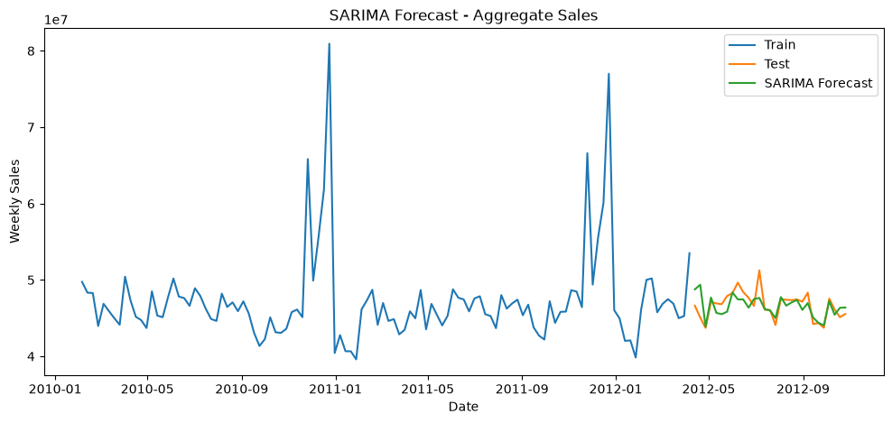
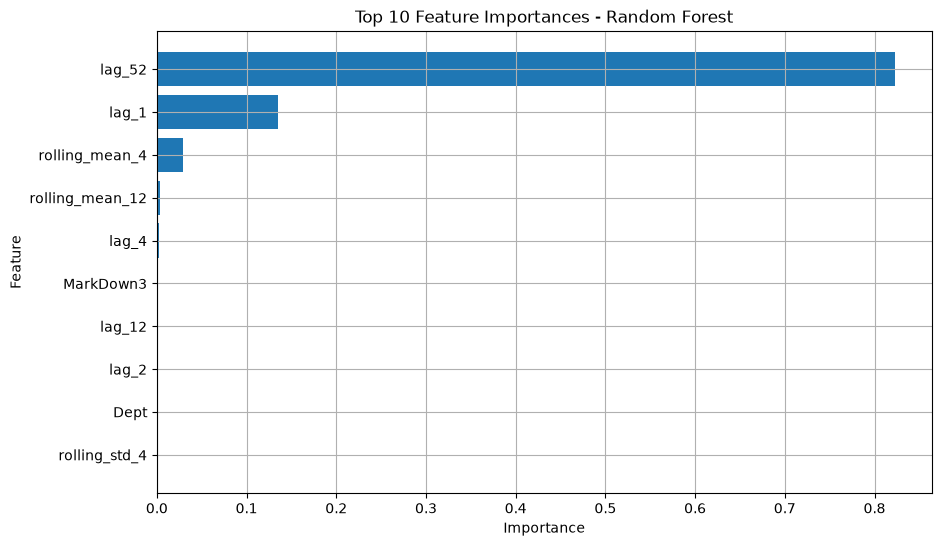

# Retail Demand Forecasting: Statistical vs. Machine Learning Models

*Capstone project, B.S. in Computer Science, American University of Armenia (supervised by Dalita A. Avanesian)*

## Executive Summary

I compared seven forecasting models on three years of weekly Walmart sales data covering 45 stores, to find out whether classical time-series methods or machine learning predict retail demand more accurately. At the total-sales level, SARIMA and Random Forest came out nearly identical, with a MAPE of 2.19% and 2.22% respectively. The result that mattered most was the reason behind it: every model that captured annual seasonality did well, and every model that didn't did poorly. Seasonality, not model complexity, drove forecast accuracy.


## Business Problem

Retailers lose money in two directions: overstocking ties up cash and creates waste, while stockouts lose sales. An industry report from IHL Group estimates that this inventory distortion cost the global retail sector about $1.73 trillion in 2025, around 6.5% of retail sales. Accurate demand forecasts are one of the most direct ways to reduce that loss.

Choosing a forecasting method is not obvious, though. Classical models such as SARIMA are interpretable and strong on stable seasonal data, while machine learning models can use many input variables and scale across thousands of series. I set out to answer a practical question: which approach gives more accurate forecasts of retail demand under identical conditions, and what explains the difference?

## Methodology

**Data.** I used the Walmart Store Sales Forecasting dataset from Kaggle: 421,570 weekly records of sales per store and department, from February 2010 to October 2012, merged with store metadata and external variables (holidays, markdowns, temperature, fuel price, CPI, unemployment). See [`data/README.md`](data/README.md) for how to download it.

**Preprocessing.** I merged the three source files, converted dates, sorted each store-department series chronologically, and filled the missing promotional markdown values with zero, since a missing markdown means no promotion was running. For the machine learning models, I engineered calendar features, sales lags (1, 2, 4, 12 and 52 weeks), and 4- and 12-week rolling statistics, always computed within each store-department series to avoid mixing information across series.

**Evaluation design.** I used a strict chronological split, training on data up to April 10, 2012 and testing on everything after it, so no future information leaked into training. Every model was measured with MAE, RMSE and MAPE. MAPE was only computed where actual sales were above zero, and it is interpreted at the aggregated level because it becomes unstable on near-zero sales at the store-department level.

**Models.** I compared three families:

| Family | Models |
|---|---|
| Baselines | Naive, 4-week Moving Average, Seasonal Naive |
| Classical time series | ARIMA(5,0,0), SARIMA(2,0,2)(1,0,0)<sub>52</sub> |
| Machine learning | Linear Regression, Random Forest (100 trees, max depth 10) |

ARIMA parameters were selected by AIC using `auto_arima`. The classical models were fit on the aggregated total weekly sales series, while the machine learning models were trained on the disaggregated store-department data and then summed to total sales for a direct comparison.

## Skills

- **Python:** pandas, NumPy, scikit-learn, statsmodels, pmdarima, matplotlib
- **Time series forecasting:** baseline models, ARIMA and SARIMA, seasonality analysis
- **Machine learning:** Random Forest, Linear Regression, feature importance analysis
- **Feature engineering:** lag variables, rolling statistics, calendar features, leakage-safe pipelines
- **Data preparation:** merging multiple sources, handling missing values, chronological train-test splitting
- **Model evaluation:** MAE, RMSE and MAPE, and understanding when a metric is misleading
- **Communication:** a full written research report with findings and recommendations

## Results & Business Recommendation

### Results

All figures below are on the held-out test period (April to October 2012) at the aggregated level.

| Model | MAE | RMSE | MAPE |
|---|---|---|---|
| SARIMA | 1,034,871 | 1,443,201 | **2.19%** |
| Random Forest | **1,028,661** | **1,352,851** | 2.22% |
| Seasonal Naive | 1,247,205 | 1,562,916 | 2.65% |
| Moving Average (4-week) | 1,591,870 | 1,901,638 | 3.44% |
| Naive | 1,648,526 | 2,419,673 | 3.52% |
| ARIMA(5,0,0) | 1,673,011 | 2,136,956 | 3.62% |
| Linear Regression | 2,263,158 | 2,576,671 | 4.91% |



Four findings stood out:

1. **SARIMA and Random Forest performed the same in practice.** SARIMA had the lower percentage error and Random Forest the lower absolute errors, but the gap is too small to call either one better.
2. **Seasonality was the deciding factor.** ARIMA and SARIMA differ only in their seasonal component, yet SARIMA cut MAPE from 3.62% to 2.19%. The Seasonal Naive model, which simply repeats last year's value, also beat the more complex ARIMA, Moving Average and Linear Regression models.
3. **Random Forest learned seasonality through its features.** The 52-week lag carried 82% of its feature importance, so the model was effectively rebuilding the annual cycle that SARIMA models directly.
4. **Metrics depend on the level of aggregation.** At the store-department level, Random Forest's MAPE was 245% and Linear Regression's was over 3,400%, driven by near-zero sales values. This is a flaw in the metric, not in the models, and it is why I compared models on total sales.



### Business recommendation

Because accuracy was nearly equal, I recommend choosing the method based on the retailer's operational needs:

- **For forecasting total demand with a clear seasonal pattern,** a well-specified SARIMA model is simple, interpretable and accurate. A Seasonal Naive forecast is also a strong, nearly free benchmark that any new model should have to beat.
- **For forecasting many store-department series at once, or using extra inputs such as promotions,** Random Forest is the more scalable option, as long as it is supplied with good lag features, particularly the previous year's value.
- **Judge models on more than one metric and at the right level.** Percentage errors on low-volume series are unreliable, so aggregate first or use alternative metrics.

### Limitations

The dataset covers only about three years, which tends to favor classical models. The comparison is also not fully symmetric, since the classical models used aggregated data while Random Forest used disaggregated data. The Random Forest hyperparameters were set manually, not tuned. These results should be read as indicative, not definitive.

## Next Steps

- Test on longer and more recent data to see whether machine learning gains an advantage as history grows.
- Add external variables to the classical models with SARIMAX, for a fairer comparison with Random Forest.
- Tune hyperparameters systematically and try gradient boosting models such as XGBoost and LightGBM.
- Add probabilistic forecasts with prediction intervals, which matter for inventory decisions.
- Evaluate with additional metrics such as MASE, and validate in a realistic deployment setting.

## Repository Structure

```
retail-demand-forecasting/
├── notebooks/      # analysis notebooks, in reading order
├── reports/        # full capstone report (PDF)
├── images/         # figures used in this README
├── data/           # data download instructions
└── requirements.txt
```

## How to Run

1. Clone the repository and create a virtual environment.
2. Install the dependencies: `pip install -r requirements.txt`
3. Download the dataset from Kaggle and place the CSV files in `data/` (see [`data/README.md`](data/README.md)).
4. Run the notebooks in the `notebooks/` folder in numerical order.

The full methodology and discussion are in [`reports/capstone_report.pdf`](reports/capstone_report.pdf).